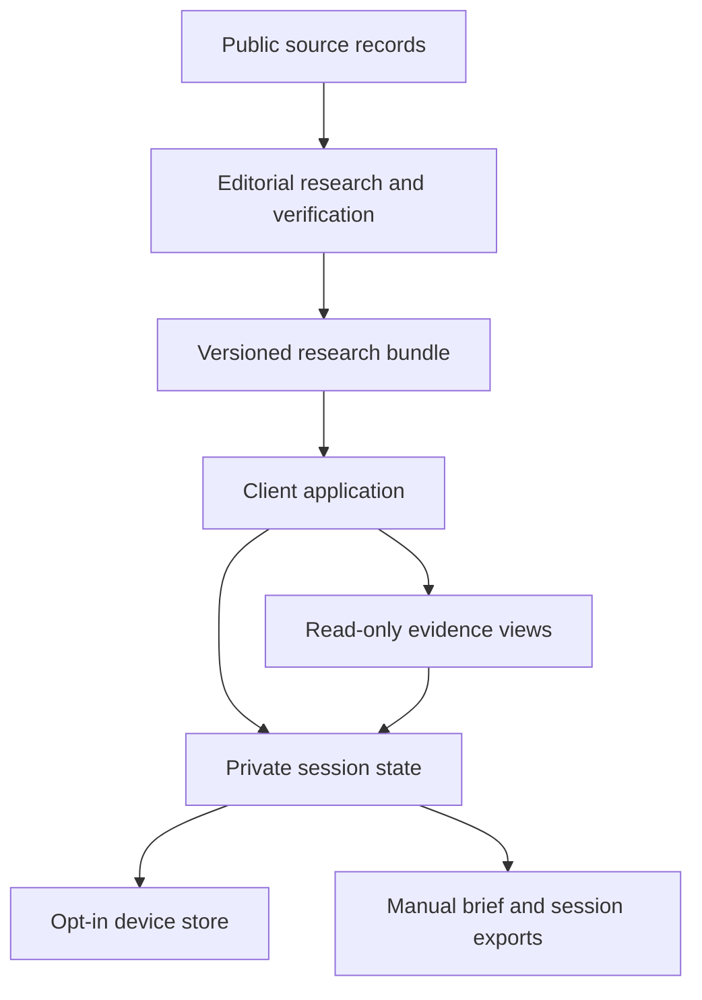

# Springdale Civic Compass

## Phase 1 architectural specification

Version: 1.2 · Date: October 10, 2026, America/Toronto  
Status: Architecture for review; baseline approved; initial implementation separately authorized.  
Scope: A private, single-device family discussion experience without accounts.  
This document defines architecture and product requirements. It contains no implementation plan, product code, or completed candidate research.

## 1. Intent and design authority

The family should be able to understand its electoral contests, compare candidates on consistent policy questions, inspect original records, and preserve its own observations and open questions. The governing principle is: **the research trail remembers what was examined; the family decides what matters.**

The approved baseline supplies four functional areas, six freely accessible journey stages, six policy themes, a versioned research snapshot, and a strict separation between evidence and family interpretation. This specification carries those decisions forward.

The guide supports neutral discussion of public electoral evidence. Household district and school-board eligibility require independent confirmation. No financial or personal profile is published.

### Success conditions

- A family can move between comparison and original evidence without losing context.
- Every published finding identifies its support, limitations, date, and jurisdiction.
- Viewing evidence never creates a family opinion or implies agreement.
- Family members can record disagreement and unanswered questions without identifying themselves.
- The family can resume an explicitly saved session and export a reproducible brief.
- The interface remains useful when evidence is missing or contested.

## 2. Boundaries and architectural decisions

| Decision | Phase 1 contract | Reason |
|---|---|---|
| Research delivery | Static, immutable, versioned research bundles | Reproducible comparisons and inspectable provenance |
| Application | Lightweight client-side application served over HTTPS | No account or family-session backend required |
| Research authoring | Separate editorial process; publication requires validation | Family notes cannot modify published evidence |
| Session persistence | Memory by default; explicit opt-in device storage | Privacy with practical recovery |
| Recovery | One active session per browser origin, plus manual portable export/import | Supports a single shared device without account management |
| Explanations | Published, source-grounded explanations reviewed before release | No live model inference or transmission of family notes |
| Comparison | Same contest, same questions, stable candidate ordering | Consistent treatment without recommendations |
| Brief | Deterministic assembly of viewed evidence and explicitly saved notes | Family curation remains visible |

A full-stack editorial platform would support frequent collaborative updates but adds unnecessary account, synchronization, and operational complexity. A fully offline evidence archive would improve independence but complicates source freshness and archival rights. Neither is the Phase 1 architecture. The application may work with its loaded snapshot when connectivity is lost, but a complete offline source archive is not promised.

Out of scope: personalized candidate recommendations, alignment scores, preference profiling, endorsements, political targeting, public publication of family notes, accounts, cloud sync, background analysis, live AI chat, financial advice or mortgage calculators, a research administration interface, and Phase 2 or Phase 3 implementation.

## 3. System boundaries and data flow

This is a logical architecture, not a deployment or task sequence. Public sources and outbound source visits are outside the application's privacy boundary. Family notes and research events stay within the browser unless the family deliberately exports them. Hosting necessarily involves ordinary requests for application and research files; no note content, agenda, session identifier, or interaction trail may be included in those requests.

| Boundary | Responsibilities and interfaces | Dependencies |
|---|---|---|
| Research loader | Validate manifest, schema, identifiers, hashes, and references; expose a read-only snapshot | Published bundle |
| Civic Journey | Maintain context, agenda, stage completion and suggested next step | Snapshot and session commands |
| Comparison Workbench | Compare candidates on a common question set; expose gaps and jurisdiction | Selected contest and issue |
| Evidence Explorer | Resolve sources, citations, decisions, outcomes and correction history | Stable evidence identifiers |
| Session controller | Apply explicit actions, maintain trail and notes, enforce local privacy | Valid snapshot and current session |
| Persistence adapter | Save, recover, import and clear session records | Explicit storage consent |
| Brief assembler | Produce preview and selected exports without adding conclusions | Pinned snapshot, trail and notes |

UI modules read derived views; only session commands mutate family state. Research objects are immutable in the running session. The brief assembler has no authority to generate a finding, a takeaway, or a candidate judgment.

## 4. Electoral context contract

The electoral context must distinguish location resolution from verified ballot information. Store location resolution status, official lookup references, applicable geography, election date, office, district, contest status, roster status, and last-checked time. Every verification must point to an authoritative electoral source.

Postal code is an initial hint. Where it is insufficient, direct the user to an official lookup outside the application and let them select the verified district. Do not retain a full street address. If confirmation remains unresolved, the user may explore research but sees “Ballot context unconfirmed.” An unconfirmed contest must not be labelled “Your ballot.”

Municipal and school-board contests require separate verification. Do not infer school-board eligibility or elector status. Display only explicitly confirmed applicable contests as the family's ballot context. General exploration can include other contests under a separate label.

Roster states are provisional, certified, and superseded. Preserve withdrawals or other changes with effective dates and source references. Do not silently delete historical candidacy. A publication that claims complete certified coverage must document verification of every applicable contest and its full roster. This specification makes no such claim.

## 5. Research and evidence contracts

All entities have stable IDs, schema version, creation/update metadata, and explicit relationships. Publication dates, event dates, retrieval times and verification times are separate fields. Unknown dates remain unknown, with any approximation labelled. An amended record retains its predecessor and correction reason.

| Entity | Required content |
|---|---|
| Research manifest | Snapshot ID, schema version, publication time, research cutoff, bundle hashes, contest coverage, verification status and correction log |
| Contest | Election reference, office, district, jurisdiction references, official roster evidence and roster status |
| Candidate | Public identity, contest-specific candidacy, documented incumbency/tenure, relevant prior roles and dated affiliation records |
| Policy question | Stable issue/question ID, common wording, jurisdiction scope and comparison fields |
| Policy claim | Candidate, exact proposition or labelled paraphrase, statement date, issue, source citations, proposed authority, funding and timeline when stated |
| Civic decision | Body, meeting and decision dates, motion identifier/text reference, disposition, recorded vote details and minutes citations |
| Outcome | Defined measure, period, geography, baseline if available, observation, source and attribution limits |
| Evidence source | Publisher, title, source type, original URL, publication/retrieval dates, locator, optional archive reference and link-check status |
| Finding | Bounded interpretation, subject/issue, supporting and conflicting citations, verification status, limitations and editorial review metadata |
| Research coverage | Candidate/question, materials and periods searched, cutoff, missingness reason and follow-up status |

A citation joins a source to a specific claim, decision, outcome, or finding using a page, section, meeting item or video timestamp and a short contextual excerpt where permitted. A general link alone cannot substantiate a recorded vote or a precise historical claim. Many findings can cite one source without duplicating the source.

### Evidence methodology

1. Establish identical question sets and research windows before candidate research.
2. Verify identity, contest, candidacy and incumbency from official records.
3. Retrieve original platforms and statements for promises; council minutes, motions, budgets and voting records for actions; published service or implementation records for outcomes.
4. Record source-specific claims before writing interpretations. Preserve dissenting evidence and material qualifications.
5. Separate a person's statement, formal action and observed result. Participation in an announcement is not proof of a vote, and a vote is not proof that the person caused an outcome.
6. Review factual support and compare coverage across candidates. Publish the cutoff and known gaps.

Campaign materials are primary evidence of what was promised, not independent evidence that it was delivered. Secondary reporting can provide context and corroboration; it must not be described as the original council record. Repeated stories derived from one record do not count as independent corroboration.

Finding verification states are **verified against primary record**, **partially supported**, **disputed**, and **unverified**. These describe support for the stated finding, not whether a policy is desirable. Display the basis and limitations rather than a numeric confidence score. Missing coverage is distinct: not located after documented search, not yet researched, source unavailable, or not applicable. None means opposition or poor performance.

### Historical performance and affiliations

Incumbents have a record track and proposal track. Challengers have a proposal track and relevant prior-experience track. No municipal record is not a negative score. Historical votes must distinguish recorded support, opposition, abstention, absence and cases where no individual vote is recorded; unknown votes must not be reconstructed from a collective decision.

For commitments, record the measurable promise, timeframe, responsible body, observed status and limits on attribution. Use “delivered,” “partly delivered,” “not delivered within the stated period,” or “cannot assess” only with defined criteria and evidence. Do not infer intentions, honesty or causation from an incomplete record.

Affiliations require explicit documentary evidence, type of relationship, time interval, source and currentness. Distinguish ballot affiliation, party membership, past candidacy, employment and endorsements. Do not treat these as interchangeable, infer party membership, or use associations as proxies for ideology.

## 6. Common policy comparison design

Each contest uses the same question set for every candidate. Topic ordering is a family agenda, not a weighting system. Candidate order defaults to alphabetical display name, with the order rule visible; there is no recommended-first sorting.

| Theme | Common research questions | Optional family discussion lens |
|---|---|---|
| Housing & development | Proposed supply, development locations, infrastructure capacity, consultation, affordability mechanism and documented decisions | Housing stability, aging in place, maintenance costs and neighbourhood access |
| Taxes & city spending | Proposed levy/service changes, funding assumptions, capital commitments, debt and documented budget decisions | Predictable household expenses and transition to retirement |
| Public safety | Proposed interventions, responsible authority, cost, evidence of effectiveness and recorded actions | Safe streets, accessible public spaces and emergency access |
| Transit & congestion | Proposed service/corridor changes, funding, delivery dependencies and measurable service outcomes | Reliable trips, alternatives to driving and access to work and services |
| Healthcare & amenities | Specific facilities/services, operating responsibilities, accessibility and intergovernmental dependencies | Access to care, recreation, learning and community participation |
| Transparency | Disclosure, conflicts, procurement, consultation, accessible records and documented practices | Whether the family can verify decisions and spending |

These are research questions, not findings about Brampton's powers or any candidate. Each populated answer must identify the responsible municipal, regional, provincial, federal or other body from sourced jurisdiction evidence. Explain what the office can directly decide, influence or request. A candidate's promise does not establish their authority to deliver it.

A candidate card presents position, mechanism, funding, timeframe, relevant record, evidence status and gaps. Specific shortcomings may include missing cost detail, documented contradictions, dependencies, or an unmet measurable commitment. Apply the same standards to all candidates and distinguish an omission in a source from proof that a plan does not exist.

The family can juxtapose these facts with its own notes. The application does not compute an alignment percentage, identify the best candidate for the household, or generate tailored reasons to vote for or against anyone.

## 7. Guided journey with free exploration

The persistent context header shows location confirmation status, contest, issue and research snapshot date. Navigation state retains stage, filters, candidate selection and evidence return target. Every stage is directly accessible; completion indicators describe activity, not mandatory gates.

| Stage | Interaction | Completion meaning |
|---|---|---|
| Your ballot | Confirm location/contest context or choose labelled general exploration | Context selected; verification status remains explicit |
| Your issues | Reorder or select the six themes; retain a route to omitted topics | Agenda explicitly accepted |
| Compare | Inspect candidates in one contest against common questions | At least one comparison explicitly opened |
| Investigate | Open source details and original records; return to comparison | At least one evidence detail explicitly opened |
| Discuss | Save observations, questions or differing interpretations | A note saved or discussion explicitly marked reviewed |
| Review | Preview scope, exclusions, gaps and export options | Brief preview inspected; exporting is optional |

Suggested next step follows the agenda and recorded stage activity. It never depends on a political preference or how positively someone discusses a candidate.

Evidence opens in a context-preserving panel or dedicated view with a return target. Original sources open separately with a notice that the external site's policies apply. On return, restore selection, filters, scroll position where practical, and keyboard focus to the invoking control. On narrow screens, use sequential comparison cards with consistent headings and an accessible comparison table option.

## 8. Session data and automatic trail

The session envelope contains session ID, session schema version, pinned research snapshot ID, timestamps, context, agenda, navigation state, stage activity, research trail, curated notes and storage preference. It contains no voter profile, financial record or inferred preference.

The automatic trail records explicit opens of candidate details, comparisons, finding details and source details, plus outbound source-link attempts. Merely rendering a card or hovering does not count as reviewed evidence. An outbound click means “original link opened,” not “document read” or “source verified.”

Use one aggregated entry per event kind, stable object ID and snapshot ID. Preserve first-opened and last-opened timestamps, count and relevant contest/issue references; repeated opens do not multiply brief entries or increase prominence. Distinguish inspected finding details from a source merely referenced by that finding. Navigation history is separate from the exported research trail.

Curated notes contain note ID, kind (observation, question, differing interpretation), text, optional evidence/context references, creation/edit times and question status (open, revisiting, resolved). An optional anonymous label such as “Family member A” can distinguish views; no login or identity verification is implied. Anyone using the shared device can edit or delete any session note. Save/edit/delete must be explicit; unsaved text receives a navigation warning. Deleting a note removes it from session storage and subsequent exports.

The research trail is not tamper-proof and does not establish who read or agreed with anything. Clearing the session deletes it. No keystroke logging, hidden engagement score, sentiment classification or behavioral analytics is permitted.

## 9. Persistence, recovery and later analysis

Default mode is **temporary session** in memory. “Save on this device” explicitly enables browser-local structured storage, with a visible explanation that other people using the same browser may access it. The selected device store is IndexedDB; storage failure leaves the active memory session intact and offers portable export.

In saved mode, successfully committed session actions persist locally and display a save indicator. Reloading recovers the active saved session after schema validation. Private browsing, browser cleanup, origin changes and device loss may remove or isolate it; the interface must not promise permanent storage. Disabling device saving deletes the persisted session but retains the current memory session until cleared or closed.

Manual portable session export produces versioned JSON containing the session and the public research snapshot needed to resolve its references. Import validates schema, IDs, size limits and text as inert content, previews the imported scope, and asks before replacing an active session. Phase 1 does not merge sessions. Multiple windows are unsupported as simultaneous editors: one obtains write ownership; others are read-only until an explicit takeover.

“Clear Session” names what will be removed and asks for confirmation. It clears memory, persisted notes, draft text, agenda and trail, then starts a fresh session. It cannot erase already downloaded exports, external browser history or browser-level backups. Do not claim secure erasure.

The portable export supports future user-initiated analysis without building an analysis service now. Future analysis must keep original notes identifiable, preserve disagreement, cite any evidence used, and label derived interpretations. It requires a separate scope decision before transmitting family content to an external service. Nothing is uploaded or analyzed in the background.

## 10. Family Civic Brief and export contract

The preview and human-readable export contain:

1. Election/contest scope and context-confirmation status.
2. Research cutoff, snapshot identity and export time.
3. Evidence inspected, with source references and limitations.
4. Explicitly selected family observations and differing interpretations.
5. Open questions and missing evidence.
6. Corrections relevant to included evidence and excluded-content indicators.

The brief is assembled deterministically from existing records. It does not paraphrase family notes into consensus, invent takeaways, turn a viewed item into an endorsement, or call all viewed material “verified.” Evidence status accompanies each factual finding.

Phase 1 provides a standalone printable HTML brief and portable JSON session export. PDF can be produced through browser printing; identical PDF pagination across browsers is not a Phase 1 guarantee. The HTML must be self-contained except for deliberate source hyperlinks, with no scripts, remote assets or embedded session JSON. Note text is escaped as text.

Before exporting, let the family choose trail, observations and questions independently and inspect the complete output. Default human-readable brief includes selected takeaways and questions; detailed trail is optional. Portable backup explicitly explains that it includes the complete session and pinned public snapshot. Default filenames and headings use the neighbourhood/project and date, not postal code, address, participant identity or financial details.

If one part is excluded, remove it from the bytes rather than hiding it visually. A temporary-session export does not enable device saving. If generation fails, preserve the session and selections and offer retry; never claim successful download merely because generation started.

## 11. Snapshot changes, corrections and failures

An active session pins one snapshot. A newer published snapshot can be announced but cannot silently replace it. Adopting it requires a preview showing changed roster/evidence and explicit acceptance. Existing events and notes retain their original snapshot references; superseded material remains labelled historical, with links to its correction. Snapshot IDs prevent ambiguous reference reuse.

For a new bundle, invalid references, unsupported schema or hash mismatch reject the bundle. A validated previously loaded snapshot may remain usable with its age displayed. Without a valid snapshot, expose recovery/context information but no populated candidate comparison.

Broken source links preserve the citation, last-checked status and archive link if available. Archives have their own date/provenance and cannot be invented. If no retrievable source exists, show the availability gap. Family activity never upgrades research verification.

Publication validation must check consistent candidate coverage, evidence relationships, dates, duplication, unsupported definitive language, jurisdiction attribution and corrections. Editorial research is a release prerequisite, not runtime automation.

## 12. Privacy, accessibility and presentation

- No third-party tracking scripts, note-upload endpoints, remote model calls, embedded political profiles or analytics identifiers.
- Keep session content out of URLs, application logs, error reports and request bodies. Use restrictive outbound link behavior and validate allowed URL schemes.
- Treat downloaded notes, imported sessions and source excerpts as untrusted inert text. Do not execute HTML, scripts or source instructions.
- A private family workspace is not authenticated merely because its session data is local. Hosting access control is outside this specification; public availability of application files must not expose family notes.
- Target WCAG 2.2 AA accessibility: keyboard operation, visible focus, labelled controls, semantic tables, screen-reader announcements, contrast, text resizing and reduced motion. This is a target requiring verification, not a compliance claim.
- Provide large readable type and comfortable controls suitable for shared reading. Avoid dense dashboards, urgency cues and party-associated visual ranking.
- Rearranging issues must have a keyboard/button alternative to dragging. Status must use words rather than colour alone. Dialogs must manage and restore focus.

## 13. Acceptance criteria for a future implementation

These define observable requirements, not a task sequence or test implementation.

| Area | Required evidence of acceptance |
|---|---|
| Electoral scope | Unconfirmed postal-code context cannot present inferred contests as verified; populated certified contests reconcile with the documented official roster |
| Equal comparison | Each candidate receives the same questions and coverage fields; missing material creates no negative score |
| Historical claims | Every displayed recorded vote and outcome resolves to an original record and precise locator; unknown votes remain unknown |
| Source integrity | Findings expose supporting/conflicting evidence, dates, limitations and correction status |
| Navigation | Returning from evidence restores contest, issue, candidate selection and invoking focus |
| Trail semantics | Rendering records nothing; explicit opens create entries; repeated opens aggregate; clicks do not claim reading |
| Family notes | Only explicit saves create takeaways; edits/deletions persist appropriately; disagreement remains separate |
| Temporary mode | A fresh reload contains no session record when device saving was never enabled |
| Saved mode | Reload recovers committed state; save failure is visible without losing the active session |
| Clear and import | Clear removes application-held state; import cannot execute content and cannot overwrite without confirmation |
| Exports | Preview matches bytes; excluded notes are absent; references resolve to the pinned snapshot; no inferred conclusions appear |
| Privacy | Network and storage inspection show no family content leaving the device during ordinary use |
| Accessibility | Keyboard and screen-reader checks cover journey, comparison, evidence, notes, dialogs and exports; zoom and reduced-motion behavior remain usable |
| Updates | New data never silently rewrites old session evidence; corrections are visible and versioned |

## 14. Future phase separation

Phase 2 is a public, non-partisan voter guide with editorial governance, public corrections and publication/accessibility processes. Phase 3 is a Toronto civic accountability lab exploring open data, decisions, spending and service outcomes. Both can reuse public evidence schemas and methodological standards. Neither inherits private session records or household discussion context.

Do not add Toronto data adapters, public publishing tools, multi-user research permissions or a universal municipal abstraction to Phase 1 merely for possible reuse.

## 15. Review decisions and completion boundary

The approved experience remains intact. This written specification proposes concrete details for review: memory-first sessions; opt-in IndexedDB recovery; manual complete-session JSON export/import; one active local session; printable HTML briefs; prepublished reviewed explanations; and version-pinned corrections.

Ballot geography, eligible contests, official election-date confirmation, candidate roster and candidate evidence remain research prerequisites before any populated experience can claim accuracy. Their absence does not prevent review of this architecture and must not be filled with fictional candidates or assumed facts.

Review this document for fit, especially recovery behavior, note handling and brief contents. Approval of this specification is separate from authorizing an implementation plan or implementation. The user subsequently authorized implementation while preserving this specification as a separate deliverable. No implementation-plan artifact has been created.

## 16. Initial implementation record

The user authorized direct implementation on October 10, 2026. The architectural requirements above remain the design contract; this section distinguishes the delivered first release from the full acceptance target.

Delivered: all journey views; a responsive editorial interface; short stage and panel transitions with reduced-motion support; keyboard focus restoration; topic inclusion and ordering; same-contest selection of up to three candidates; source inspection; explicit trail aggregation; editable and removable family notes; question status; temporary sessions; opt-in IndexedDB recovery; manual JSON backup/import; selective standalone printable HTML briefs; clear-session controls; and a browser tab ownership lock where the Web Locks API is supported.

Research snapshot `springdale-2026-10-10-v1` includes official roster entries for mayor, City and Regional Councillor Wards 9/10, English Public Trustee Wards 9/10, and English Separate Trustee Wards 7/8/9/10: 44 candidates. French-language trustee contests and other districts are not included. District and school-board context require family confirmation. The City election page confirms October 26, 2026. Source-grounded campaign statements are included for Janice Gordon-Daniels, Harkirat Singh, and Patrick Brown, plus official City/Peel budget context and Brown's documented historical party leadership. This is partial coverage, not a completed voter guide. No current party membership, individual recorded council votes, or independently attributed delivery outcomes are claimed.

Sources checked October 10, 2026:

- [Official certified roster](https://www.brampton.ca/EN/City-Hall/Election/Candidates/Pages/candidateListing.aspx)
- [Official election information](https://www.brampton.ca/EN/City-Hall/Election)
- [Janice Gordon-Daniels priorities](https://www.janicegordon.ca/priorities/)
- [Harkirat Singh project account](https://harkiratsingh.ca/economic-development-projects/)
- [Patrick Brown campaign launch](https://votepatrickbrown.com/media/campaign-launch/)
- [Official mayor biography](https://www.brampton.ca/en/city-hall/mayor-office/pages/biography.aspx)
- [City budget announcement](https://www.brampton.ca/EN/City-Hall/News/Pages/News-Release.aspx/1631)
- [Peel budget announcement](https://peelregion.ca/press-releases/peel-regions-2026-budget-approved-council)

Verification completed: JavaScript syntax checks and automated checks for trail aggregation, explicit note creation and editing, actual exclusion of unchecked content from exports, inert note text, backup validation, relationship integrity and included roster counts. Browser QA was unavailable in this environment. Responsive appearance, animation quality, real browser storage/download behavior, screen-reader behavior and WCAG conformance are not claimed verified.

Remaining architectural acceptance gaps: exhaustive policy/history research; full council-motion and outcome entities; source-bundle cryptographic validation; adoption and migration across changed research snapshots; source correction workflows; and complete browser/accessibility verification. Imports currently accept only the bundled snapshot ID and restore family state against the trusted bundled public evidence; unknown snapshots are rejected. Backups include a public evidence copy for reference, but imported public data is not executed or used to replace trusted evidence. No background updates occur. Multiple-tab editing protection requires Web Locks; unsupported browsers should use one tab.

Motion contract: 450 ms entrance transitions with short staggered issue cards, 320 ms dialog transitions, and restrained hover feedback. The compass uses one initial settling motion rather than an ongoing loop. All nonessential transitions and animations are disabled under reduced-motion preferences. Motion communicates navigation and action feedback; it does not signal candidate favourability.

## 17. Civic Atlas revision and review specification

Revision date: October 11, 2026 UTC (October 10 in Toronto). The user requested a more refined visual and interaction design, sourced portraits, a full candidate directory, a municipal hierarchy, and richer comparison graphics. These are implemented requirements, not an implementation plan.

### Municipal map and roster contract

The municipal landscape groups offices by City government, regional representation, and independent school-board systems. These branches organize election research; they do not depict a superior/subordinate reporting structure. A stable race colour accompanies an office code, office name, district, candidate count, and textual status. Focus outlines identify the user-selected race, without ranking race importance or recommending any candidate.

The new snapshot `springdale-2026-10-11-v2` includes 47 certified people across seven contests: mayor; City and Regional Councillor Wards 9/10; English Public Trustee Wards 9/10; English Separate Trustee Wards 7/8/9/10; French Public Trustee Viamonde; and French Separate Trustee MonAvenir. The official list marks Genevieve Grenier acclaimed. Other Brampton wards are outside this Springdale research scope. All 47 appear in the default directory; search and race focus visibly state the number shown. A three-person cap applies only to side-by-side comparison. Four board systems are exploratory alternatives, not four trustee votes for one elector.

Seven portraits are sourced from candidate websites and self-hosted. Metadata records source page, credit and retrieval date; original asset URLs are retained in `assets/portraits-provenance.json`. Missing portraits use a labelled neutral silhouette. No portrait was generated. Campaign-origin imagery is not a claim of unedited photographic authenticity. Portrait identification and source placement were inspected; identity cannot be established from appearance alone.

### Comparison instrument contract

| Lens | Encoding | Evidence boundary |
|---|---|---|
| Policy matrix | Six theme rows, selected-candidate columns, source-opening cells | Empty cells mean not yet researched; no polarity or quality score |
| History | Common 2014–2026 axis with dated source controls | Marks denote documented events; connecting lines do not imply continuous tenure |
| Connections | Coloured curved paths into labelled categorical lanes | Historical party role, professional connection and unknown are distinct; no left–right score or probability density |
| Promises and outcomes | Statement → decision/funding → delivery → measured outcome checkpoints | Only the sourced statement checkpoint is populated; self-reported achievements do not fill independent delivery or outcome stages |
| Topic detail | Consistent candidate cards with statement, limits and history | Common questions and missingness treatment for incumbents and challengers |

Comparison colours identify selected people and remain consistent across lenses. They are independent of party colours. Every chart also uses names, labels and explicit source controls. The timeline and connections are incomplete research records. Quantified ideological positioning is not supported by the retrieved evidence and is not displayed. Outcome absence means cannot assess, not failure. The new campaign material expands topic coverage for Sukhman Sangha, Nirmala Devi Madhu, Prabh Gill, Paul Tarriwal and Gurpreet Singh Dhillon. Wesley Jackson's platform is linked but not yet extracted into topic cells. Trustee policy extraction remains a gap.

### Motion and visual design

The revision uses the Industrial Instrument direction described in the user's [griotwave-ui repository](https://github.com/TheDigitalGriot/griotwave-ui), with its genuine tale/song/drum easing tokens. Warm reading surfaces surround a charcoal map and comparison instrument. Race colours carry structure; missingness is communicated in text. The application self-hosts Anime.js 4.2.2 (MIT). Entrance transitions use 460 ms motion with bounded 28 ms stagger; connection paths resolve over 850 ms. Motion reveals information joining a structure. It never encodes candidate quality. Reduced-motion preferences bypass Anime.js transitions and stop active animation when changed.

The named `griot-motion-design` skill was not loaded. The skill was not available in the build environment. The connected repositories did not expose `digital-griot-skills` or the exact skill. Genuine Griotwave tokens were used; no equivalence with the missing skill is claimed.

### Snapshot adoption and preservation

The original v1 research module is retained as an immutable bundled archive. Previously saved v1 sessions prompt the family to adopt expanded research, back up the earlier session, or explore a temporary session. Adoption preserves earlier trail snapshot references and note origin while pinning further research to v2. Brief exports resolve earlier source-open references against the v1 source archive and label their snapshot. Backups from v1 offer explicit adoption during restore. Imported evidence cannot replace trusted bundles. A temporary-session save warns before replacing a pending older saved session.

A full editorial correction log, cryptographic bundle integrity validation and arbitrary snapshot migration remain architectural gaps. This release supports only the specifically retained v1 archive and current v2 bundle.

### Verification boundary

JavaScript syntax, 18 automated checks, roster relationships, real asset presence, chart source references, unknown-evidence semantics, session adoption and brief exclusion were checked. Anime.js exports were verified. Browser QA is unavailable because the supported browser-control skill is not present. Responsive layout, perceptual motion quality, actual download/storage behavior and complete keyboard/screen-reader conformance still require browser review; no WCAG certification is claimed.

Code review identified and resolved legacy-session startup recovery, independent-reporting classification, and hostile imported note identifiers. Regression checks cover each. Full backups include history, affiliation and race metadata plus the retained earlier research bundle.
